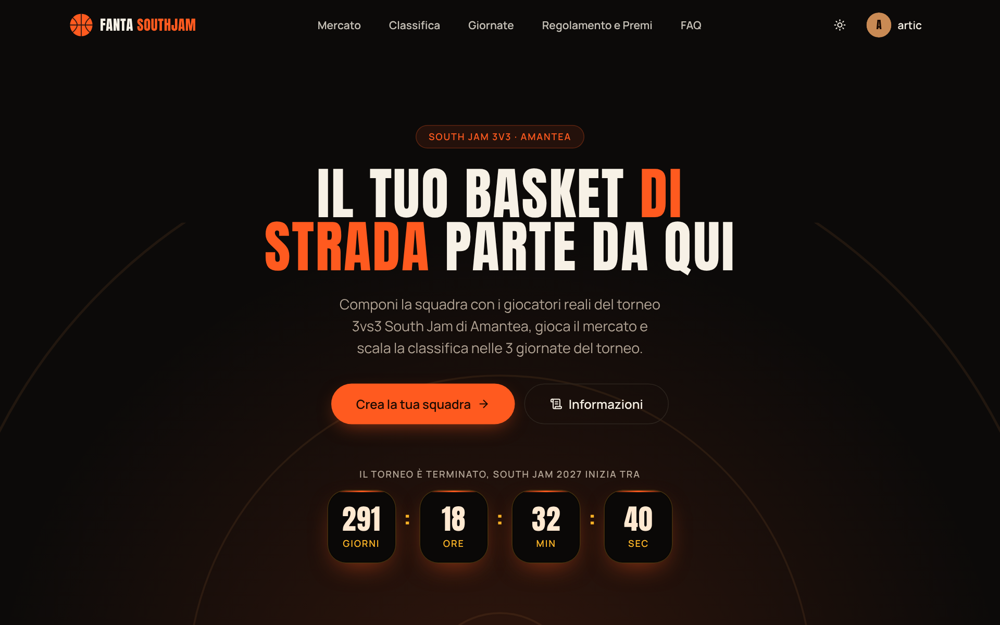
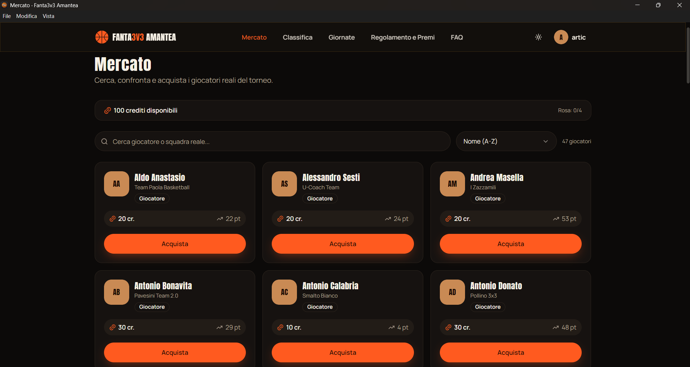
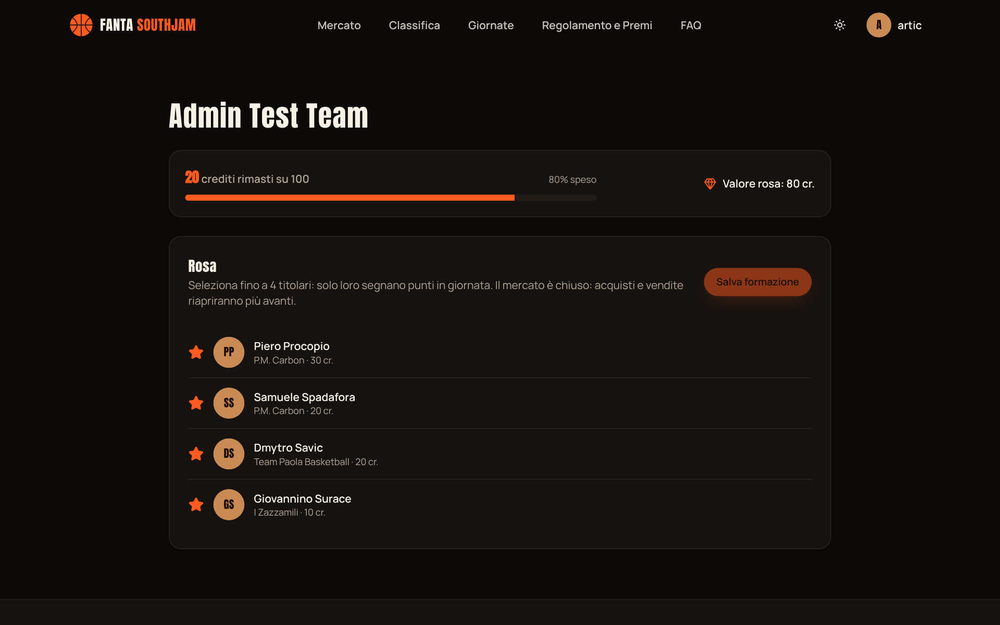
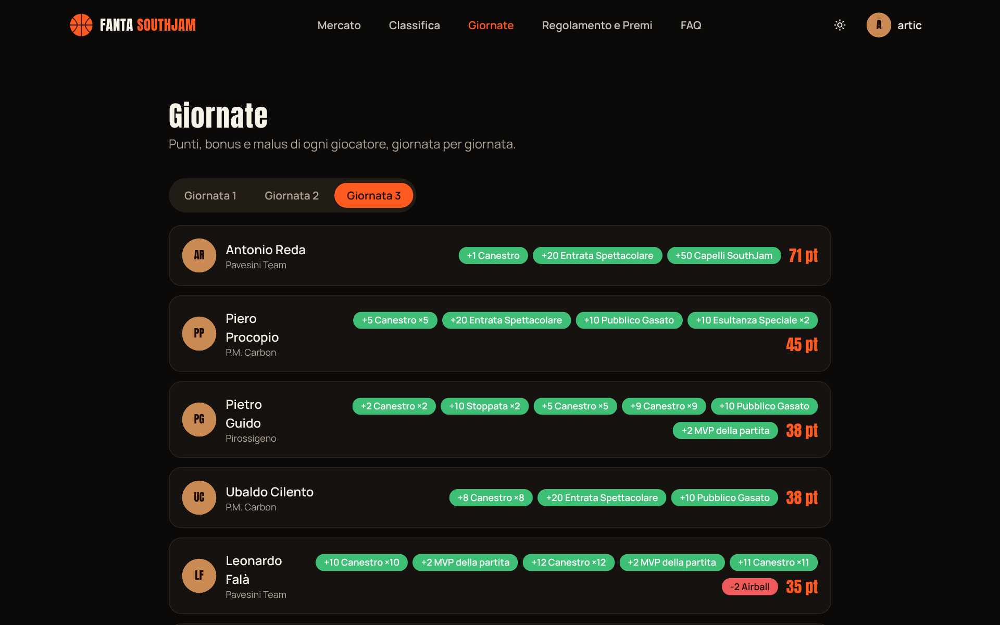
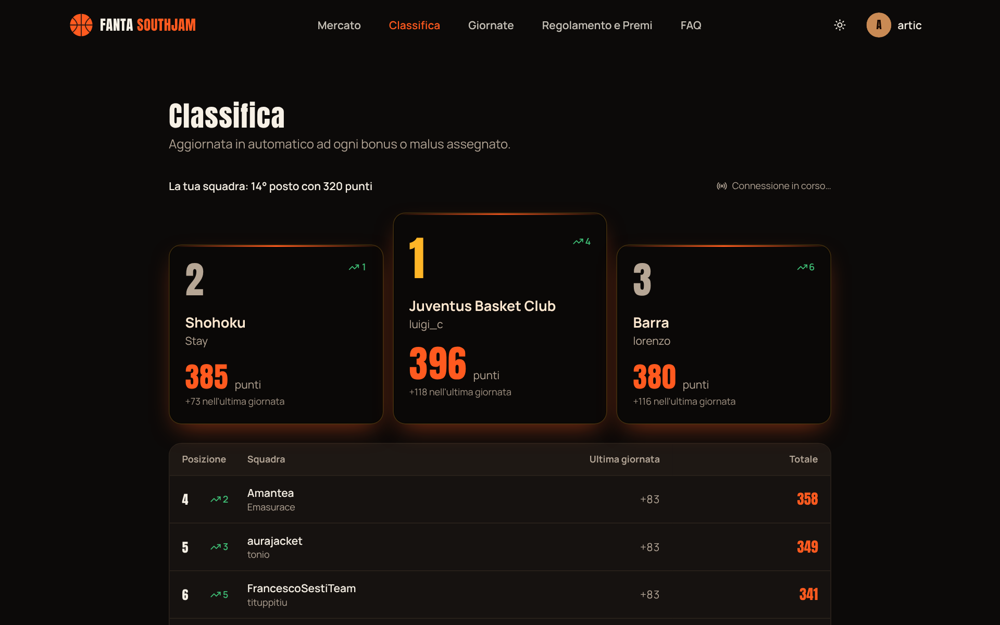
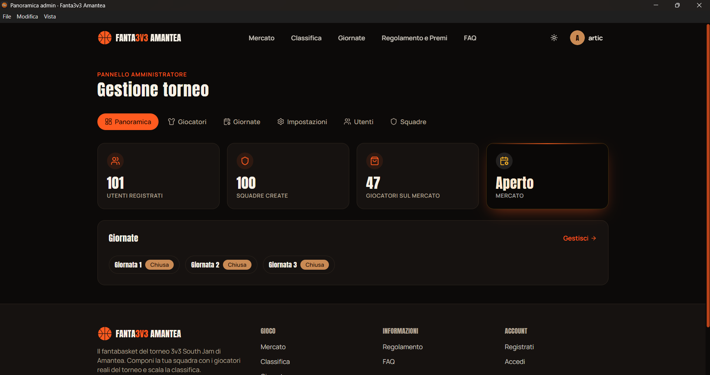

# 🏀 FantaSouthJam — Fanta3v3 Amantea

Web app di **fantabasket** costruita per il torneo di basket 3vs3 di Amantea. A differenza dei fantasy classici,
i giocatori acquistabili sono i **partecipanti reali del torneo**: ogni utente crea la propria squadra con un
budget a crediti, sceglie titolari e riserve e scala la classifica man mano che l'organizzazione assegna
bonus e malus dopo ogni giornata.

> Progetto full-stack completo, dal database alla UI, pensato per essere usato davvero durante un evento reale.



> Le schermate di questa pagina usano un account di prova con dati inventati.

## Funzionalità

### Per i partecipanti
- Registrazione, login e recupero password (Supabase Auth).
- Home con countdown all'inizio del torneo, regolamento e FAQ.

### Mercato e squadra
- **Mercato a crediti** con ricerca, filtri e ordinamento; il budget è verificato lato database.
- Creazione della squadra e gestione della rosa: titolari e riserve, acquisto e vendita dei giocatori.





### Giornate e classifica
- **Giornate** (il torneo ne conta 4) con punteggi e dettaglio di bonus e malus per ogni giocatore.
- **Classifica in tempo reale** (Supabase Realtime): si aggiorna da sola senza ricaricare la pagina.
- Pagina pubblica di ogni squadra con rosa e storico.





### Pannello admin (`/admin`, solo ruolo `admin`)
- Gestione giocatori: aggiunta, modifica, costi, rimozione dal mercato (disattivazione *soft*, per non rompere
  lo storico di chi li ha già posseduti).
- Gestione giornate: stato, recap testuale, assegnazione di bonus e malus per giocatore.
- Impostazioni: apertura e chiusura del mercato, budget iniziale, dimensione di rosa e titolari, data di inizio
  torneo, testo del regolamento.
- Elenco di utenti e squadre.
- **Audit log** automatico di ogni azione admin, scritto da un trigger del database.



## Scelte tecniche

- **La logica critica sta nel database**, non nel client: acquisto/vendita sono funzioni Postgres
  `SECURITY DEFINER` che controllano budget, dimensione rosa e stato del mercato in modo atomico.
- **Punteggi e classifica sono calcolati da trigger**: quando l'admin assegna un bonus/malus, `player_scores`,
  i punteggi di squadra e `rankings` si aggiornano da soli; la vista `current_rankings` alimenta dashboard e classifica.
- **Row Level Security** su tutte le tabelle: ogni utente può modificare solo i propri dati, le azioni admin
  sono vincolate al ruolo.
- **Realtime** sulla tabella `rankings` per la classifica live.
- Validazione con **Zod** + **React Hook Form**, layer di servizi (`src/services`) separato dall'interfaccia.
- Middleware Next.js per proteggere le rotte private e quelle admin.

## Stack

| Area | Tecnologie |
|---|---|
| Frontend | Next.js 15 (App Router), React 19, TypeScript |
| UI | Tailwind CSS v4, componenti in stile shadcn scritti a mano, Lucide Icons |
| Form e validazione | React Hook Form, Zod |
| Backend | Supabase: Auth, Postgres, RLS, Realtime |
| Deploy | Vercel |

## Modello dati

12 tabelle: `profiles`, `players`, `fantasy_teams`, `fantasy_team_players`, `matchdays`, `bonus_types`,
`player_score_events`, `player_scores`, `rankings`, `transactions`, `settings`, `admin_logs`.
Le migration sono in `supabase/migrations/`.

## Installazione

Requisiti: Node.js 20+ e un progetto [Supabase](https://supabase.com) gratuito.

```bash
git clone https://github.com/smnbrn/FantaSouthJam.git
cd FantaSouthJam
npm install
cp .env.local.example .env.local
```

Compila `.env.local` con i valori di Project Settings → API:

```
NEXT_PUBLIC_SUPABASE_URL=https://xxxxxxxxxxxx.supabase.co
NEXT_PUBLIC_SUPABASE_ANON_KEY=...
SUPABASE_SERVICE_ROLE_KEY=...        # solo server-side, mai esporla al client
NEXT_PUBLIC_SITE_URL=http://localhost:3000
```

### Database

Nel SQL Editor di Supabase esegui, **in ordine**:

1. `supabase/migrations/0001_init.sql` — tabelle, RLS, funzioni di acquisto/vendita, trigger di punteggio
2. `supabase/migrations/0002_rankings_view_and_realtime.sql` — vista `current_rankings` e Realtime
3. `supabase/migrations/0003_admin_audit_log.sql` — log automatico delle azioni admin

Poi promuovi il tuo account ad amministratore (unico passaggio manuale in SQL):

```sql
update public.profiles set role = 'admin' where username = 'il_tuo_username';
```

Da qui giocatori, giornate, bonus/malus, mercato e regolamento si gestiscono dal pannello `/admin`.

### Avvio

```bash
npm run dev
```

Apri [http://localhost:3000](http://localhost:3000).

## Deploy su Vercel

1. Importa la repository su Vercel
2. Imposta le stesse variabili di `.env.local` (con `NEXT_PUBLIC_SITE_URL` uguale al dominio di produzione)
3. Deploy

## Struttura

```
src/
  app/            Route (App Router): (site) pagine con navbar, (auth) autenticazione, admin, auth/callback
  components/     ui, layout, home, auth, dashboard, squadra, mercato, classifica, giornate, squadre, admin
  services/       Accesso ai dati Supabase (giocatori, squadre, giornate, classifica, impostazioni, admin)
  lib/            Client Supabase e schemi di validazione
  middleware.ts   Protezione delle rotte
supabase/migrations/   Schema, RLS, funzioni e trigger
```

## Licenza

Distribuito con licenza [MIT](LICENSE).

I nomi dei giocatori sono quelli di partecipanti reali al torneo: se riutilizzi il progetto, usa dati tuoi o
di fantasia.
